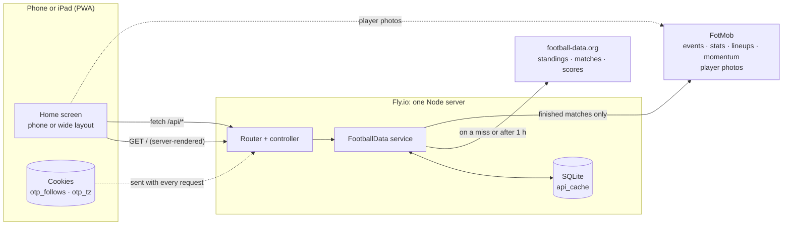
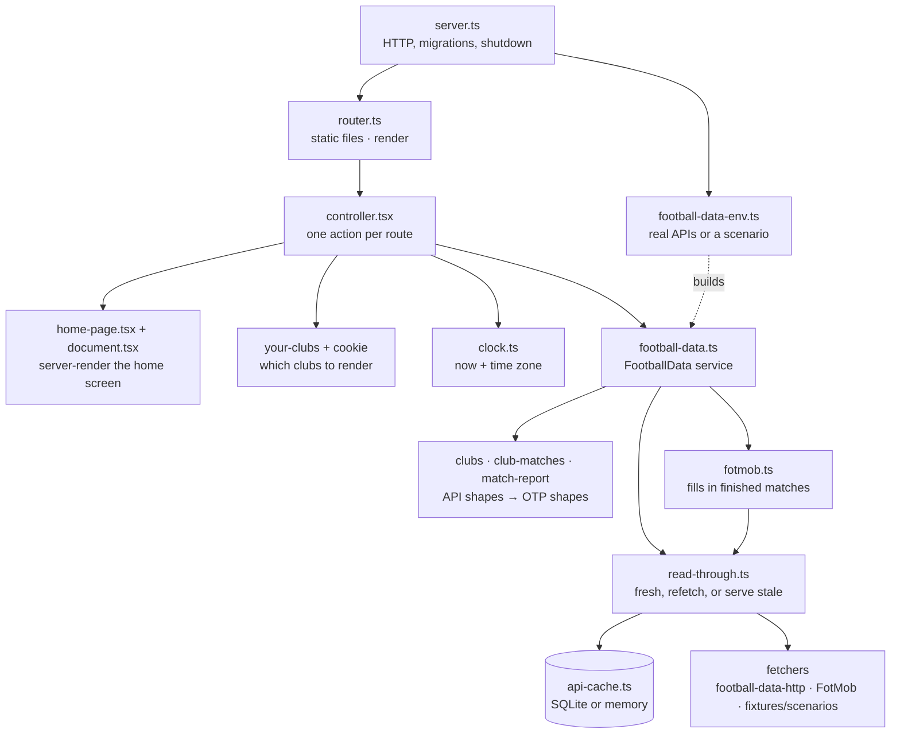
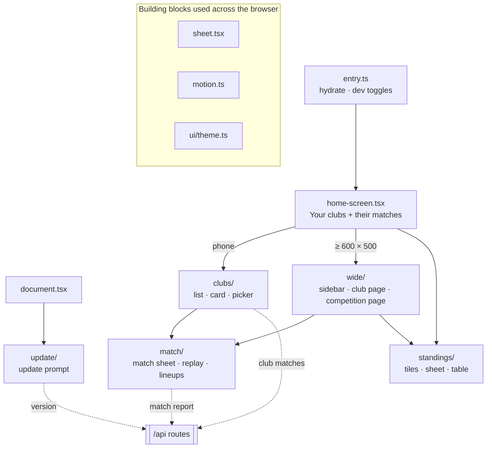

# Architecture

A map of what On the Pitch is made of and how the parts connect, as of the last PR that touched it. Read it to find your way around. For what things are called, see [CONTEXT.md](CONTEXT.md). For why they are the way they are, see [docs/adr/](docs/adr/).

**Keep it current:** a PR that adds, removes, renames or rewires a component updates this file in the same PR (see [AGENTS.md](AGENTS.md)). [`app/architecture.test.ts`](app/architecture.test.ts) fails when a component on disk is missing here or a path here no longer exists.

## The system

One Node server on Fly.io renders the page and answers three small JSON routes. Everything upstream goes through a SQLite read-through cache, so while upstream is healthy each response is fetched at most once an hour. The one exception is images: crests and player photos load in the browser straight from their hosts.

## Server

A request goes through `server.ts` → router → controller → the FootballData service. The service is the only thing that talks to the outside world. [`app/lib/football-data-env.ts`](app/lib/football-data-env.ts) decides at startup whether it talks to the real APIs or to a fixture scenario.

| Component | Code | What it does |
|---|---|---|
| Server entry | [`server.ts`](server.ts) | Starts the HTTP server, runs migrations, closes the database on shutdown. |
| Wiring | [`app/lib/football-data-env.ts`](app/lib/football-data-env.ts) | Reads env and builds the service: real APIs with SQLite, or `OTP_SCENARIO` fixtures with a memory cache. Pins the clock with `OTP_NOW` and `OTP_TZ` in dev. |
| Routes | [`app/routes.ts`](app/routes.ts) | The URL contract shared by server and browser: `/`, `/api/clubs/:clubId/matches`, `/api/clubs/:clubId/matches/:matchId`, `/api/version`, `/assets/*`. |
| Router | [`app/router.ts`](app/router.ts) | Serves `public/` with no-cache, installs the render middleware and maps routes to the controller. |
| Controller | [`app/actions/controller.tsx`](app/actions/controller.tsx) | One action per route. Home reads the cookies, loads standings and Your clubs' matches, then renders. |
| Page shell | [`app/actions/home-page.tsx`](app/actions/home-page.tsx), [`app/actions/document.tsx`](app/actions/document.tsx) | The HTML document (import map, theme tokens, update prompt) around the home screen. |
| Assets | [`app/assets.ts`](app/assets.ts) | Compiles and serves browser modules under `/assets`. |
| FootballData | [`app/lib/football-data.ts`](app/lib/football-data.ts) | The one service the controller uses: tracked competitions, a club's matches, a match report. Only serves reports for results a club card shows. |
| FotMob | [`app/lib/fotmob.ts`](app/lib/fotmob.ts) | Finds the same match on FotMob and fills in events, stats with xG, lineups and momentum ([ADR-0005](docs/adr/0005-fotmob-fills-in-match-reports.md)). |
| Read-through cache | [`app/lib/read-through.ts`](app/lib/read-through.ts), [`app/lib/api-cache.ts`](app/lib/api-cache.ts), [`app/lib/freshness.ts`](app/lib/freshness.ts) | Serves a fresh copy, refetches a stale one, and falls back to stale when the fetch fails. Fresh means under one hour ([ADR-0001](docs/adr/0001-football-data-read-through-cache.md)). |
| HTTP fetcher | [`app/lib/football-data-http.ts`](app/lib/football-data-http.ts) | Calls football-data.org with the API key. |
| Database | [`app/db.ts`](app/db.ts), [`app/data/tables.ts`](app/data/tables.ts), [`db/migrations/`](db/migrations/) | A SQLite file (in memory under test) with one table, `api_cache`. |
| App version | [`app/lib/app-version.ts`](app/lib/app-version.ts) | Names the running deploy (the commit SHA from CI) for `/api/version`. |

## Shared domain

Pure modules in `app/lib/` that both the server and the browser import. They turn API shapes into what OTP draws and do no I/O.

| Component | Code | What it does |
|---|---|---|
| Clubs | [`app/lib/clubs.ts`](app/lib/clubs.ts) | Clubs and club sections, derived from standings. |
| Club matches | [`app/lib/club-matches.ts`](app/lib/club-matches.ts) | A season of matches → form (last five results) and the next fixtures. |
| Standings | [`app/lib/standings.ts`](app/lib/standings.ts) | Lookups over tables: a club's row, the rows around it. |
| Match report | [`app/lib/match-report.ts`](app/lib/match-report.ts) | What the match sheet draws, cut from `/v4/matches/{id}` ([ADR-0004](docs/adr/0004-match-sheet-reads-events-only.md)). |
| Match replay | [`app/lib/match-replay.ts`](app/lib/match-replay.ts) | A report as a timeline: moments, score states, momentum swings. |
| Formatting | [`app/lib/match-format.ts`](app/lib/match-format.ts) | Dates, times and countdowns, always in the clock's time zone. |
| Clock | [`app/lib/clock.ts`](app/lib/clock.ts) | The instant and time zone a render uses, so server and browser format the same thing. Owns the `otp_tz` cookie. |
| Your clubs | [`app/lib/your-clubs.ts`](app/lib/your-clubs.ts), [`app/lib/your-clubs-cookie.ts`](app/lib/your-clubs-cookie.ts) | The `otp_follows` cookie → the clubs to show, in order ([ADR-0002](docs/adr/0002-your-clubs-in-a-cookie.md)). |
| Competition metadata | [`app/lib/competition-metadata.ts`](app/lib/competition-metadata.ts) | Short name, colours and mark for each tracked competition. |
| API types | [`app/lib/types/`](app/lib/types/) | football-data.org response shapes. |
| Utils | [`app/lib/utils.ts`](app/lib/utils.ts) | `tryCatch`, which turns a promise into a result tuple. |

## Browser

The server renders `HomeScreen` and the browser hydrates it. One component picks the phone or wide layout. Both layouts open the same match sheet and standings sheet.

| Component | Code | What it does |
|---|---|---|
| Browser entry | [`app/actions/public/entry.ts`](app/actions/public/entry.ts) | Hydrates the page and installs the perf and motion-lab toggles. |
| Home screen | [`app/actions/public/home-screen.tsx`](app/actions/public/home-screen.tsx) | The top client component. Holds Your clubs and their matches, picks the layout, writes the `otp_tz` cookie. |
| Clubs (phone) | [`app/actions/public/clubs/`](app/actions/public/clubs/) | The club list (one open card, the rest as rows), the club card's timeline (form strip and next-match pager), the club picker, and the browser side of Your clubs. Fetches and caches club matches. |
| Match sheet | [`app/actions/public/match/`](app/actions/public/match/) | A finished match: header, a replay strip you can scrub, a momentum curve, both lineups with a card per player, stats and key moments. Fetches and caches reports. |
| Standings | [`app/actions/public/standings/`](app/actions/public/standings/) | Competition tiles, plus the standings sheet and its table. |
| Wide layout | [`app/actions/public/wide/`](app/actions/public/wide/) | iPad and unfolded iPhone Duo: a slide-over sidebar plus club and competition pages laid out from column plans. |
| Update prompt | [`app/actions/public/update/`](app/actions/public/update/) | Watches `/api/version` and offers a reload when a newer deploy is live. |
| Sheet | [`app/actions/public/sheet.tsx`](app/actions/public/sheet.tsx) | The depth sheet: the screen behind it recedes as it rises. |
| Motion | [`app/actions/public/motion.ts`](app/actions/public/motion.ts) | Hand-rolled springs and the animation clock ([ADR-0003](docs/adr/0003-hand-rolled-springs.md)). |
| Theme | [`app/ui/theme.ts`](app/ui/theme.ts), [`app/ui/logo.tsx`](app/ui/logo.tsx) | Design tokens (OKLCH colours, rem spacing) and the logo. |

## Dev tooling

| Component | Code | What it does |
|---|---|---|
| Fixtures | [`app/fixtures/`](app/fixtures/) | Builders for data in football-data's real shapes, plus `OTP_SCENARIO` scenarios (`matchday`, `api-down`, `no-fixtures`, `league-down`). |
| Perf HUD | [`app/actions/public/perf/`](app/actions/public/perf/) | A render counter overlay. Turn it on with `?perf=1` or five quick taps. |
| Motion lab | [`app/actions/public/motion-lab/`](app/actions/public/motion-lab/) | Slow motion, pause, frame step and per-element traces, at `?motion=0.25`. Scriptable through `window.__otpMotion`. |
| Motion capture | [`scripts/motion/`](scripts/motion/) | Playwright before/after captures and reports (`bun run motion:capture`, `motion:report`). |
| HMR | [`hmr.ts`](hmr.ts) | The `bun run hmr` dev server. |
| CI and deploy | [`.github/workflows/`](.github/workflows/), [`Dockerfile`](Dockerfile), [`fly.toml`](fly.toml) | Typecheck and tests on every PR. `main` deploys to Fly with `APP_VERSION` set to the commit SHA. |

## Not built yet

- A club screen. Prototypes exist outside `main`, awaiting a pick.
- Animation plans 002–005 in [`plans/`](plans/README.md).

## Deeper dives

- [`docs/club-matches/data-flow.html`](docs/club-matches/data-flow.html): how a newly added club's matches arrive.
- [`docs/club-matches/store.html`](docs/club-matches/store.html): where club matches live, server and browser.
